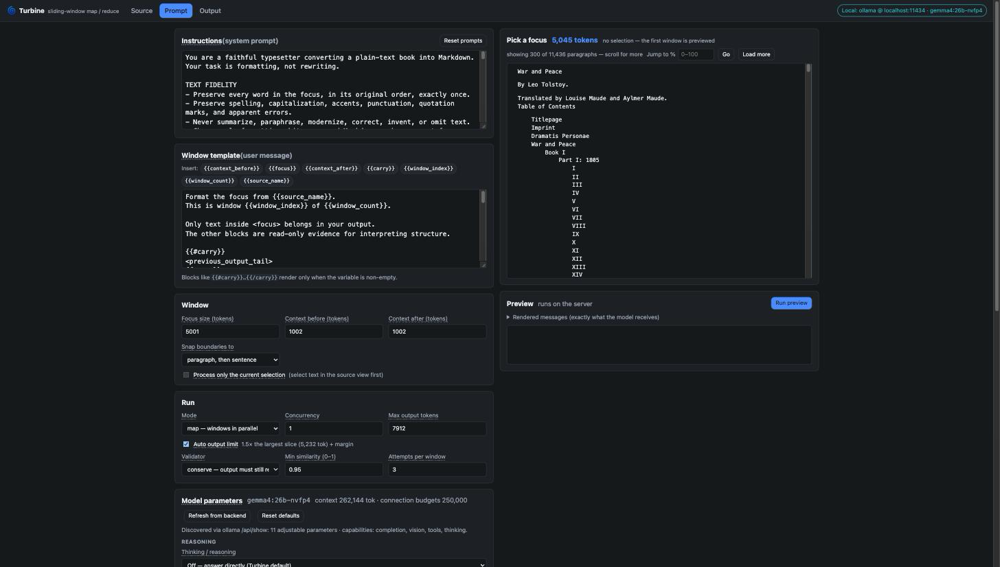
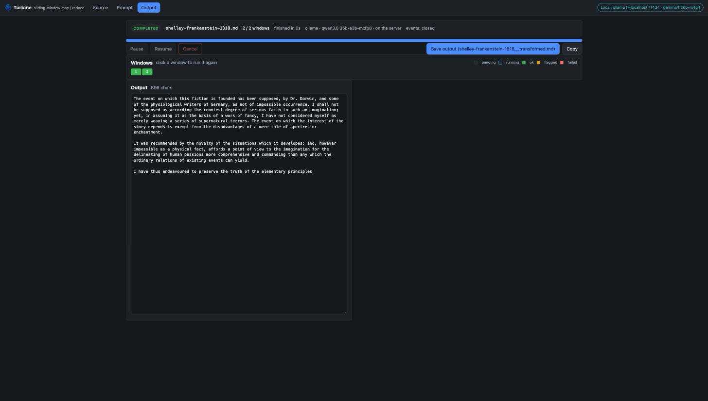

# llm-tools

Small, sharp tools for working with language models. Some are single HTML files you can open from disk; one is a full app.

<p align="center">
  
</p>

## 🌀 Turbine — a programmable sliding-window map/reduce pump for long documents

**[`single-page-hosted-apps/turbine/`](single-page-hosted-apps/turbine/)** · [full README](single-page-hosted-apps/turbine/README.md)

Feed Turbine a 1,000-page book and a prompt. It tiles the text into windows, sends each one to the model with read-only context on either side, validates the output, checkpoints every window, and stitches the results back into one document. Think of it as a pump: text goes in one end, transformed text comes out the other, with many repetitions in between.

- **Bring your own inference.** Ollama, vLLM and llama.cpp on your machine or LAN; OpenRouter (400+ models), OpenAI and Anthropic in the cloud. One connection page, one key vault, one countdown.
- **Map or fold.** Run windows in parallel, or sequentially with the previous output carried forward when continuity matters.
- **Preview before you commit.** Select any span of the source, even one line, and watch the model transform exactly that with the real prompt and context, streaming, with a live token counter.
- **Tokens, not guesses.** A Rust/WASM tokenizer in the browser, recalibrated by the model's own usage numbers after every preview, so the plan's budget and the backend's reality agree.
- **Model parameters discovered, not assumed.** Turbine asks each backend what the model accepts, shows those knobs, keeps reasoning off by default, and lets you turn it on where the model supports it.
- **Conserve mode.** A validator that strips Markdown and checks the words survived, so a formatting pass over an embeddings corpus keeps Darwin's prose and not the model's.
- **Safe to host.** Keys are encrypted in the browser under your passphrase and held server-side only in memory until the session timer runs out. A public deployment never fetches user-supplied URLs.

Built with [DiamondJS](https://github.com/Node0/diamondjs) on the front end and [Elysia](https://elysiajs.com) on Bun at the back. Building it shook out five DiamondJS bugs, all fixed in v2.2.3.

```bash
cd single-page-hosted-apps/turbine
bun install && bun run build && bun run start   # http://localhost:7331
```

<p align="center">
  
</p>

## Static single-page apps

Self-contained HTML files in **[`single-page-static-apps/`](single-page-static-apps/)**. Open them in a browser; no server, no build.

| App | What it does | Try it |
|---|---|---|
| **Tokens Per Second Simulator** | Type a tokens-per-second rate, pick a corpus, and watch text stream at that speed. Useful for feeling what a model's throughput number means. | [GitHub Pages](https://node0.github.io/llm-tools/single-page-static-apps/tkps_simulator.html) |
| **Text Stats Analyzer** | Characters, lines and a whitespace token estimate for any pasted text. | [GitHub Pages](https://node0.github.io/llm-tools/single-page-static-apps/text_stats_analyzer.html) |
| **OpenAI TTS Inspector** | Poke at OpenAI's text-to-speech endpoint from a single page. | open `openai_tts_inspector.html` |

## Scripts

- **`python-tools/`** — an Ollama CLI prompt utility and a tokens-per-second versus GPU-count optimizer.
- **`cli-tools/`** — shell helpers.
- **`single-page-hosted-apps/turbine/tools/fetch_corpus.ts`** — builds a 3×3 public-domain corpus (250 / 500 / 1,000-page tiers across neuroscience, an adjacent science and a literary control) from Project Gutenberg, normalized to Markdown without any LLM in the loop.

## Contributing

Issues and pull requests are welcome. Turbine's engine, server and client each have their own tests: `bun test` inside the turbine folder runs them all.

## License

AGPL-3.0. See [LICENSE](LICENSE).
